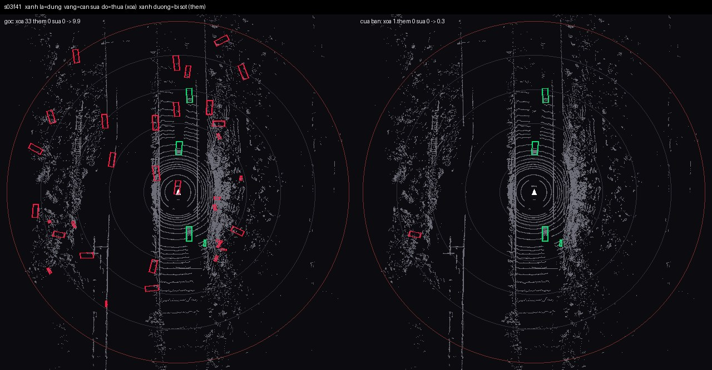

# Báo cáo Day 14 — Vũ Tiến Vinh — 2A202603269

- Mã học viên dùng với `--student`: `2A202603269`
- `seed_tag` trong `frames_A.txt`: `7c6f404fb0`

## 1. Dự đoán trước sweep (bước 5b)

Ghi **trước** khi chạy `scripts/pp_sweep.py`, rồi commit và push ngay (lịch sử commit là bằng chứng thời điểm viết). Không sửa phần này sau khi có kết quả.

- Tham số tôi nghĩ giảm công sửa nhiều nhất: score_thr
- Vì sao (nhìn ảnh BEV tập A: box thừa nhiều hay box sót nhiều?): Sau khi đối chiếu dự đoán gốc với nhãn tôi đã sửa trên 3 frame tập A, số box cần xóa là 69, trong khi chỉ cần thêm 2 box và chỉnh 8 box. Riêng frame s03f41 có 33 box cần xóa. Vì vậy, tôi dự đoán tăng score_thr sẽ lọc bớt các dự đoán có độ tin cậy thấp, giúp giảm số box thừa và công xóa thủ công. Tuy nhiên, ngưỡng quá cao có thể loại cả các box đúng, làm tăng số vật thể phải thêm lại. Tôi sẽ kiểm chứng dự đoán này bằng kết quả sweep.

## 2. Tập A: sửa tay và tune

| Cấu hình | Xóa | Thêm | Sửa | Chi phí |
|---|---:|---:|---:|---:|
| Gốc | 69 | 2 | 8 | 26.7 |
| `best_config.json` | 7 | 9 | 4 | 13.1 |

- Tham số đã đổi trong `best_config.json`: tăng `score_thr` từ 0.1 lên 0.5 và tăng `min_points` từ 0 lên 10.
- Kết quả leave-one-out (chọn trên các frame còn lại, chấm trên frame bỏ ra):

```text
s01f47: cấu hình chọn {'score_thr': '0.5', 'min_points': '10'} → 8.0 (tốt nhất có thể 7.9)
s03f41: cấu hình chọn {'score_thr': '0.4', 'min_points': '10'} → 2.4 (tốt nhất có thể 0.3)
s04f58: cấu hình chọn {'score_thr': '0.5', 'min_points': '10'} → 4.8 (tốt nhất có thể 3.5)
```

- Cấu hình có ổn định trên từng frame không? Vì sao tôi vẫn chọn (hoặc không chọn) nó: Cấu hình chưa ổn định hoàn toàn giữa các frame. Trong ba lượt leave-one-out, `min_points=10` đều được chọn, nhưng `score_thr` thay đổi giữa 0.4 và 0.5. Với `s01f47`, chi phí 8.0 gần mức tốt nhất 7.9; với `s03f41` và `s04f58`, chi phí lần lượt là 2.4 và 4.8, cao hơn mức tốt nhất tương ứng 0.3 và 3.5. Điều này cho thấy cấu hình chọn từ hai frame chưa chắc phù hợp nhất với frame còn lại. Tôi vẫn chọn `score_thr=0.5`, `min_points=10` vì cấu hình này có tổng chi phí thấp nhất trong 15 cấu hình thử trên cả tập A: giảm từ 26.7 xuống 13.1, tương đương khoảng 50.9%. Số box cần xóa giảm từ 69 xuống 7 và số box cần chỉnh giảm từ 8 xuống 4, nhưng số box cần thêm tăng từ 2 lên 9. Theo công thức chi phí của lab, lợi ích giảm xóa và chỉnh box vẫn lớn hơn chi phí thêm box bị sót. Tuy nhiên, chỉ có 3 frame tune nên tôi chưa thể khẳng định cấu hình này sẽ tốt nhất trên tập B; các box và vật thể bị bỏ sót vẫn cần được kiểm tra thủ công.

## 3. Trước/sau (bước 8)



- `scripts/pp_compare.py` báo giảm 51% công sửa trên tập A (làm tròn; tính từ 26.7 xuống 13.1 là khoảng 50.9%).

| Frame | Chi phí gốc | Chi phí sau tune |
|---|---:|---:|
| `s01f47` | 12.1 | 8.0 |
| `s03f41` | 9.9 | 0.3 |
| `s04f58` | 4.7 | 4.8 |
| **Tổng** | **26.7** | **13.1** |

- Dự đoán ở mục 1 đúng hay sai? Giải thích bằng số box xóa/thêm/sửa: Dự đoán của tôi đúng về xu hướng trên toàn tập A: tăng ngưỡng lọc giúp giảm box thừa và tổng chi phí sửa. Sau tune, số box cần xóa giảm từ 69 xuống 7, số box cần chỉnh giảm từ 8 xuống 4, trong khi số box cần thêm tăng từ 2 lên 9. Tổng chi phí giảm từ 26.7 xuống 13.1, tương đương khoảng 50.9%. Kết quả sweep cũng cho thấy khi giữ `min_points=0`, chỉ tăng `score_thr` từ 0.1 lên 0.5 đã giảm chi phí từ 26.7 xuống 13.4; tăng tiếp `min_points` lên 10 chỉ giảm thêm 0.3 điểm. Vì vậy, trong phạm vi các cấu hình đã thử trên tập A, `score_thr` là tham số đóng góp chính vào việc giảm công sửa, phù hợp với dự đoán ban đầu. Tuy nhiên, hiệu quả không đồng đều: `s03f41` giảm mạnh từ 9.9 xuống 0.3, còn `s04f58` tăng nhẹ từ 4.7 lên 4.8. Việc lọc mạnh hơn cũng làm tăng số box bị sót cần thêm lại.

## 4. Tập B

Số đo từ lệnh:

```powershell
python scripts/pp_prelabel.py --data "$DataVF" --frames "d14_2A202603269/frames_B.txt" --config "d14_2A202603269/best_config.json" --gt "d14_2A202603269/ref_B.json"
```

Cấu hình dùng cho tập B: `score_thr=0.5`, `min_points=10`. Có đủ 12 frame có nhãn, với 142 box tham chiếu, 159 box dự đoán và 115 cặp khớp theo phép ghép box của lab trong phạm vi 50 m.

| Xóa | Thêm | Sửa | Chi phí |
|---:|---:|---:|---:|
| 44 | 27 | 52 | 66.2 |

Chi phí được tính bằng `0.3 × 44 + 1.0 × 27 + 0.5 × 52 = 66.2`.

| Frame | Box dự đoán | Xóa | Thêm | Sửa | Chi phí |
|---|---:|---:|---:|---:|---:|
| `s02f04` | 13 | 2 | 2 | 3 | 4.1 |
| `s02f24` | 12 | 3 | 3 | 2 | 4.9 |
| `s02f53` | 16 | 9 | 0 | 4 | 4.7 |
| `s03f00` | 13 | 0 | 2 | 5 | 4.5 |
| `s03f31` | 7 | 4 | 1 | 2 | 3.2 |
| `s03f49` | 12 | 5 | 0 | 1 | 2.0 |
| `s04f15` | 13 | 2 | 1 | 7 | 5.1 |
| `s04f34` | 9 | 1 | 3 | 5 | 5.8 |
| `s04f50` | 7 | 1 | 3 | 5 | 5.8 |
| `s05f12` | 27 | 8 | 6 | 7 | 11.9 |
| `s05f30` | 20 | 8 | 0 | 6 | 5.4 |
| `s05f45` | 10 | 1 | 6 | 5 | 8.8 |
| **Tổng** | **159** | **44** | **27** | **52** | **66.2** |

Theo trọng số của lab, xóa box đóng góp 13.2 điểm chi phí, thêm box đóng góp 27.0 điểm và chỉnh box đóng góp 26.0 điểm. Frame `s05f12` có chi phí cao nhất (11.9), tiếp theo là `s05f45` (8.8). Đây là số đo từ phép ghép box, không phải số thao tác chuột hoặc thời gian sửa thực tế.

- Loại box tốn công sửa nhất ở tập B: Xét theo dạng lỗi và trọng số của lab, box bị sót cần thêm lại đóng góp chi phí lớn nhất: 27 box tương ứng 27.0 điểm, nhỉnh hơn 52 box cần chỉnh với 26.0 điểm và cao hơn 44 box thừa cần xóa với 13.2 điểm. Nếu xét số lượng, box cần chỉnh là nhóm nhiều nhất. Hai frame `s05f12` và `s05f45` đều cần thêm 6 box, có chi phí tổng lần lượt là 11.9 và 8.8, cho thấy cần chú ý kiểm tra vật thể bị bỏ sót ở các frame này. Log chưa tách lỗi theo lớp hoặc theo tâm, kích thước và góc xoay nên tôi chưa thể kết luận Car, Cyclist hay Pedestrian tốn công nhất, hoặc dạng sai lệch hình học nào phổ biến nhất. Kết quả tập B cho thấy cấu hình đã tune vẫn cần kiểm tra thủ công cả box thừa, vật thể bị sót và box chưa chính xác; chưa có số đo cấu hình gốc trên tập B để kết luận mức giảm công sửa trên tập này.

## 5. Giới hạn

- Tập A chỉ có 3 frame; cấu hình có chi phí thấp nhất trên tập A chưa chắc phù hợp với các cảnh khác. Leave-one-out chọn `score_thr` khác nhau giữa 0.4 và 0.5.
- Model được huấn luyện trên KITTI với ba lớp Car, Cyclist và Pedestrian. Truck/Bus được suy ra bằng quy tắc kích thước, không phải hai lớp được model học trực tiếp.
- Chi phí `0.3 × xóa + 1.0 × thêm + 0.5 × sửa` là thước đo quy ước, chưa phản ánh thời gian sửa thật. Phép chấm chỉ xét box trong phạm vi 50 m và phụ thuộc vào chất lượng nhãn tham chiếu được sửa thủ công.
